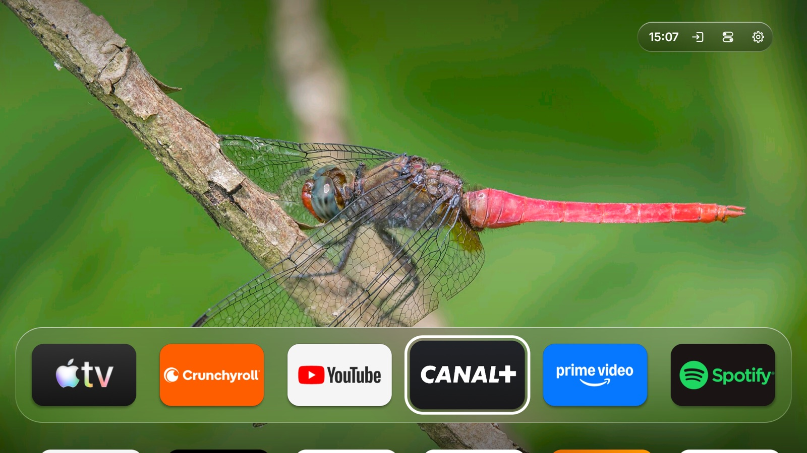
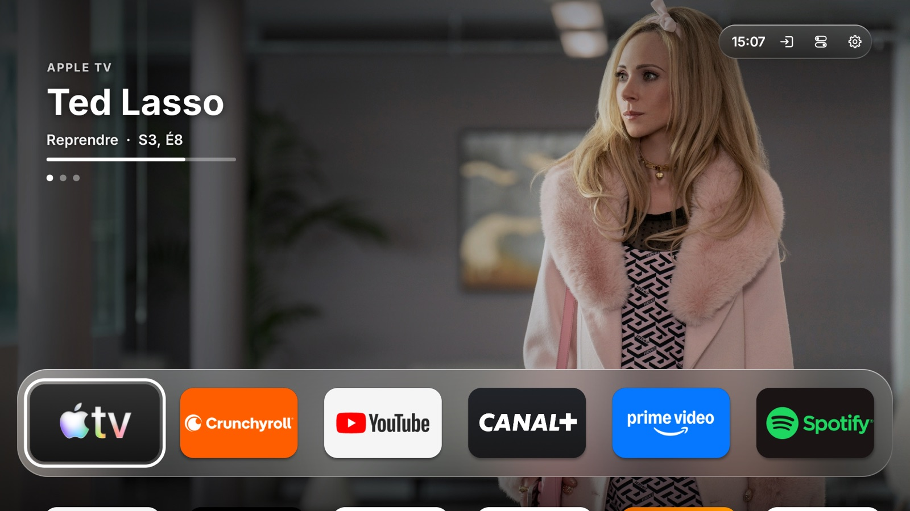
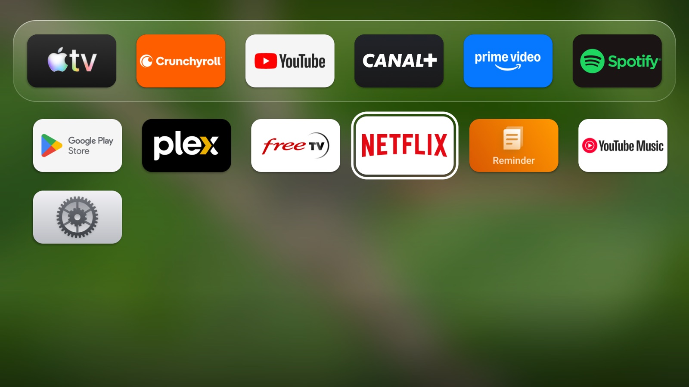
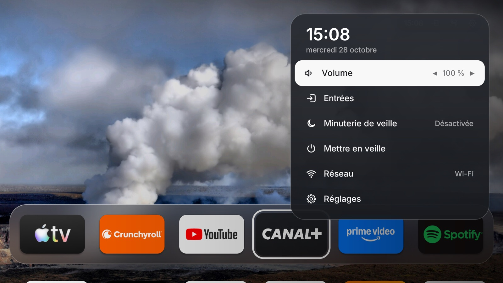
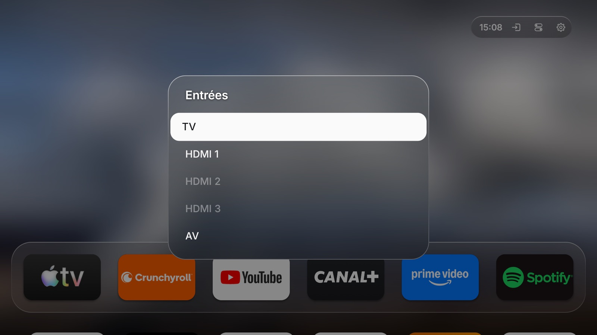
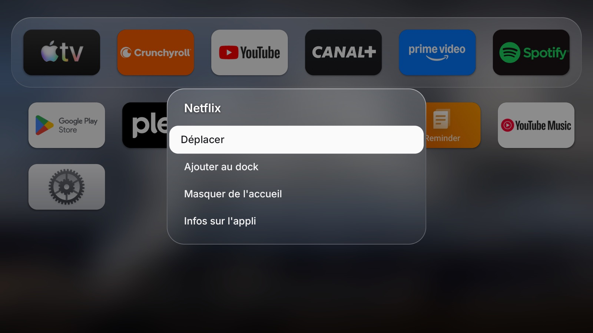
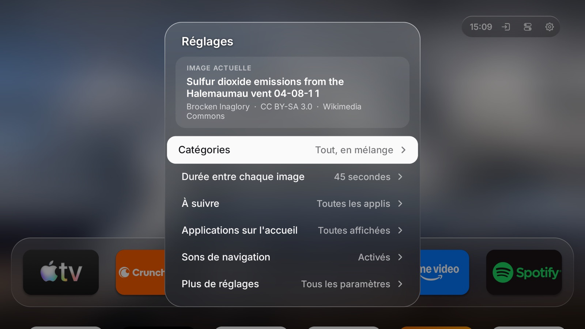
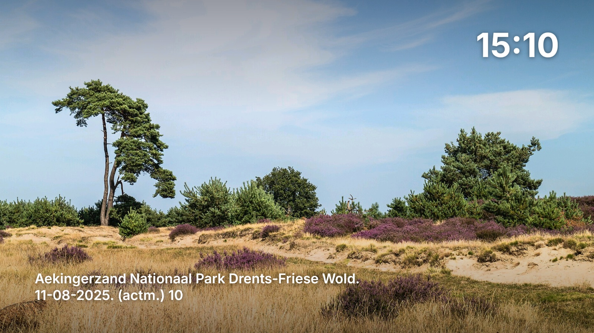

# Accueil TV

[English](README.md) · **Français**

**Un accueil rapide et sans pub pour Android TV / Google TV, façon Apple TV.**
Un dock de tes applis préférées, des fonds d'écran qui tournent, tes derniers programmes dans
« À suivre », un centre de contrôle, et les boutons de la télécommande branchés sur tout ça.
Open source (MIT). Rien n'est désinstallé, tout est réversible.



---

## Installation

Télécharge l'installateur de ton ordinateur et ouvre-le :

- **macOS** (Intel et Apple Silicon, macOS 12 ou plus) : [AccueilTV-Installer-macOS.dmg](https://github.com/Leptitluc/android-apple-tv/releases/latest/download/AccueilTV-Installer-macOS.dmg)
- **Windows** (10 et 11) : [AccueilTV-Installer-Windows.exe](https://github.com/Leptitluc/android-apple-tv/releases/latest/download/AccueilTV-Installer-Windows.exe)

L'installateur s'ouvre dans ton navigateur, en français ou en anglais. Il t'explique quoi faire sur
la télé, la trouve sur ton réseau, **fait une sauvegarde**, télécharge le nécessaire (les outils
Android et Accueil TV) et installe tout automatiquement : allègement (pubs, télémétrie, applis de
démonstration — tu choisis pour les applis que tu pourrais utiliser), bouton réglages, économiseur
d'écran et accueil par défaut. Environ 5 minutes. Relance-le et choisis « Tout annuler » pour remettre
la télé comme avant.

**Premier lancement :** les installateurs ne sont pas signés avec un certificat payant d'Apple ou de
Microsoft, donc le système te prévient une fois.
- **macOS 15 et plus récent** : ouvre l'appli, clique sur « OK », puis va dans **Réglages Système →
  Confidentialité et sécurité** et clique sur **« Ouvrir quand même »** en bas. Sur macOS 12 à 14 :
  clic droit sur l'appli → **Ouvrir**.
- **Windows** : sur « Windows a protégé votre ordinateur », clique sur **« Informations
  complémentaires »** → **« Exécuter quand même »**.

### À faire d'abord sur la télé (une seule fois)

1. **Paramètres → Système → À propos**, puis appuie **7 fois** sur « Version d'Android TV OS » (ou
   « Numéro de build ») jusqu'au message « Vous êtes développeur ».
2. **Paramètres → Système → Options pour les développeurs → Débogage USB** : active-le.
3. Note l'adresse IP : **Paramètres → Réseau et Internet**.

Pendant l'installation, la télé affichera **« Autoriser le débogage USB ? »** : accepte et coche
**« Toujours autoriser »**.

### Avancé : en ligne de commande (macOS / Linux)

Sur **ton ordinateur** (même Wi-Fi que la télé), colle ceci dans un terminal :

```bash
bash <(curl -fsSL https://raw.githubusercontent.com/Leptitluc/android-apple-tv/main/install.sh)
```

Le script demande ta langue, puis fait les mêmes étapes que l'installateur, dans le terminal.

Sans curl (en clonant le dépôt) :

```bash
git clone https://github.com/Leptitluc/android-apple-tv.git
cd android-apple-tv
./install.sh            # ou ./install.sh 192.168.1.20
```

Pour sauter la question de la langue, ajoute `ACCUEIL_TV_LANG=fr` (ou `en`) devant la commande.

---

## Ce que tu obtiens

<table>
  <tr><td width="50%"><br><sub><b>À suivre</b> : arrête-toi sur une appli du dock pour voir ses programmes</sub></td><td width="50%"><br><sub><b>Toutes tes applis</b> sous le dock, dans l'ordre que tu choisis</sub></td></tr>
  <tr><td width="50%"><br><sub><b>Centre de contrôle</b> : volume, entrées, veille, réseau</sub></td><td width="50%"><br><sub><b>Entrées</b> : celles sans appareil allumé sont en transparence</sub></td></tr>
  <tr><td width="50%"><br><sub><b>OK maintenu</b> sur une tuile : déplacer, ajouter au dock, masquer</sub></td><td width="50%"><br><sub><b>Menu rapide</b> : fonds d'écran, À suivre, applis, sons</sub></td></tr>
  <tr><td width="50%"><br><sub><b>Économiseur d'écran</b> : tes fonds d'écran, l'heure et le lieu</sub></td></tr>
</table>

- **Pas de pub.** Aucune rangée sponsorisée, aucune bannière.
- **Un dock** de tes applis récentes, et une grille de toutes les applis alignée dessous. Maintiens OK
  sur une tuile pour l'ajouter au dock, l'en retirer, ou choisis « Déplacer » pour la placer où tu veux,
  comme sur Apple TV. Dès que tu le modifies, le dock ne garde que tes choix (1 à 6 applis, centrées).
- **Le focus façon tvOS** : la tuile choisie s'incline légèrement du côté de la flèche pressée, puis
  revient à plat pendant qu'un reflet lumineux glisse dessus. Désactivé si les animations de la télé sont coupées.
- **Des sons de navigation** : un petit « tic » à chaque déplacement, un son plus plein à la validation,
  comme sur Apple TV. Désactivables dans le menu rapide de l'accueil.
- **Des fonds d'écran** qui tournent (nature, art, architecture, nuit… réglable), avec crédits. La
  catégorie « Selon l'heure » montre des paysages lumineux le jour et des ciels étoilés le soir.
- **« À suivre »** : arrête-toi sur une appli du dock et ses derniers programmes s'affichent en plein
  écran, comme le « top shelf » de tvOS, repris là où tu t'étais arrêté. Les applis sans programme en
  cours montrent leurs recommandations à la place (par exemple les recommandations YouTube). Un visuel à
  la résolution de l'écran s'affiche en plein écran ; plus petit, il devient une vignette nette sur fond
  flouté, jamais étirée.
- **Menu rapide** sur l'accueil : catégories de fond d'écran, durée, quelles applis nourrissent
  « À suivre », afficher/masquer les applis, et « Plus de réglages ».
- **Les entrées** (HDMI, AV, antenne…) à portée de clic, à côté de l'heure, avec le nom des
  appareils branchés quand la télé le fournit. Les entrées sans appareil allumé sont en
  transparence. Le bouton entrées de la télécommande ouvre le même
  menu. Le bouton n'apparaît pas sur les box sans entrée.
- **Un centre de contrôle**, comme sur Apple TV : maintiens le bouton réglages de la télécommande (ou
  choisis l'icône à interrupteurs à côté de l'heure) pour ouvrir un panneau par-dessus n'importe quelle
  appli : volume, entrées, minuterie de veille, mise en veille, réseau et réglages. Les options de
  veille n'apparaissent que sur les télés qui les gèrent.
- **Lecture en cours** : quand une musique ou une vidéo joue, sa pochette et son titre s'affichent à
  côté de l'heure, et le centre de contrôle propose lecture/pause, précédent et suivant.
- **Un économiseur d'écran façon Apple TV** : tes fonds d'écran avec un zoom lent, l'heure, et le lieu
  affiché quelques secondes sur chaque image, comme les vidéos aériennes de tvOS. L'installeur le sélectionne pour toi.
- **Le bouton réglages** de la télécommande ouvre les paramètres de la télé.
- **Rapide et léger**, et **réversible** : une sauvegarde est faite avant toute modification.

## Compatibilité

Android TV / Google TV, Android 8 ou plus récent. L'installeur reconnaît les marques courantes
(TCL, Vestel/Toshiba…) pour l'allègement ; sur les autres, il applique une base sûre et te demande
pour le reste. Certaines télés protègent le bouton « Source » au niveau système : il restera alors
sur le menu d'origine.

## Tout annuler

Rouvre l'installateur et choisis **« Tout annuler sur une télé déjà installée »**. Il utilise la
sauvegarde faite à l'installation : lance-le depuis le même ordinateur. En ligne de commande :

```bash
bash <(curl -fsSL https://raw.githubusercontent.com/Leptitluc/android-apple-tv/main/restaurer.sh)
```

ou, depuis un clone : `./restaurer.sh`. Les applis désactivées sont réactivées, les réglages
d'origine rétablis et Accueil TV désinstallé. La langue choisie à l'installation est reprise.

## Construire soi-même (facultatif)

```bash
# macOS
brew install --cask temurin android-commandlinetools android-platform-tools
sdkmanager "build-tools;34.0.0" "platforms;android-34"
./build.sh      # produit app/AccueilTV.apk
```

Pas de Gradle : `build.sh` enchaîne aapt2 → javac → d8 → zipalign → apksigner. Garde le fichier
`accueil-tv.keystore` créé au premier build pour signer tes futures versions avec la même clé.

Les installateurs (Go, sans dépendance) se construisent sur un Mac :

```bash
brew install go
installer/build.sh 1.0.0   # produit installer/dist/AccueilTV-Installer-macOS.dmg et -Windows.exe
```

Publie les deux fichiers dans une « release » GitHub pour que les liens de téléchargement ci-dessus
fonctionnent. Pour essayer l'installateur sans toucher à la télé : depuis le dossier `installer`,
`go run . -dry-run`.

## Sécurité et vie privée

Aucun compte, aucun traqueur. Les modifications passent toutes par `pm disable-user` (réversible),
jamais de désinstallation d'appli système. Les fonds d'écran sont téléchargés sur la télé depuis
Wikimedia Commons.

L'installeur donne à Accueil TV l'accès aux notifications : c'est la seule voie qu'offre Android pour
savoir ce qui est en lecture (titre, pochette, lecture/pause). Accueil TV ne lit que les sessions de
lecture, ne garde rien et n'envoie rien. Il choisit aussi l'économiseur d'écran d'Accueil TV.
`restaurer.sh` retire l'accès aux notifications et remet les réglages d'économiseur d'origine.

## Licence

MIT — voir [LICENSE](LICENSE).
